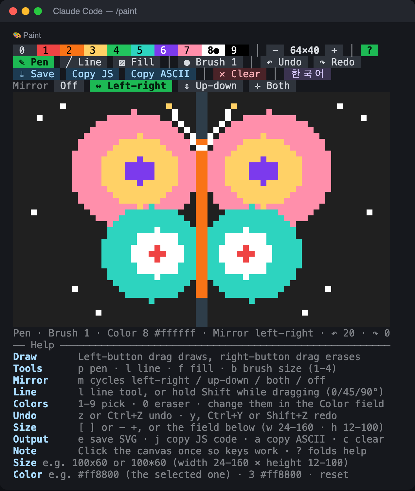

# paint

A paint canvas that lives in a [Claude Code](https://claude.com/claude-code) pane. Open it with `/paint` and draw with the mouse.

- Drag to draw (left button), drag with the right button to erase
- Palette of 9 colors plus an eraser, brush sizes 1-4, flood fill, straight lines
- **Mirror mode**: draw one half and the other half follows (left-right, up-down, or both)
- **Custom colors**: change any of the nine palette colors to any `#rrggbb` (a field under the canvas, or `/paint color 3 #ff8800`)
- Undo / redo (20 steps), resizable canvas, English and Korean
- Save as SVG, or copy the drawing as a JS/TS array or as ASCII art
- A help block with all the shortcuts sits under the canvas (fold it with `?`); the status line shows the tool, brush, color, undo depth and mirror mode

<p align="center">
  
</p>

<p align="center"><sub><b>Preview, not a terminal capture:</b> rendered from the mod's own drawing code, with the butterfly drawn through its mouse handlers on the left half only (mirror mode on), using a customized palette. Fonts and colors will differ in your terminal.</sub></p>

> **Status: early (0.9).** It was built against Claude Code's mod API and tested with a simulated engine and the API's type definitions. How mouse drags, `Shift` and `Ctrl+Z` reach it depends on your terminal (see [Terminals](#terminals)). Issues and reports of what works where are welcome.

## Install

```
/plugin install paint --marketplace kwonsean/claude-code-paint
```

(Claude Code 2.1.275 or later. Or from a shell: `claude plugin marketplace add kwonsean/claude-code-paint`, then `claude plugin install paint@claude-code-paint`.) Restart Claude Code, then run `/paint`.

## Use

`/paint` opens the pane. Click the canvas once so the keys reach it.

| | |
|---|---|
| Draw / erase | drag with the left / right mouse button |
| Colors | `1`-`9`, `0` is the eraser (or click the swatches). Change a color: see [Custom colors](#custom-colors) |
| Tools | `p` pen, `l` line, `f` fill, `b` brush size (1-4) |
| Mirror | `m` cycles off → left-right → up-down → both → off, or click the chips on the fourth menu row |
| Straight line | the `Line` tool (`l`), or hold `Shift` while dragging (snaps to 0 / 45 / 90°) |
| Undo / redo | `z` or `Ctrl+Z` / `y`, `Ctrl+Y` or `Shift+Z` |
| Clear | `c` (undoable) |
| Save | `e` writes `~/Pictures/paint-<time>.svg` |
| Copy as code | `j` copies the drawing, cropped, as `const SPRITE = ["..R..", ...]` plus a `PALETTE` |
| Copy as ASCII | `a` copies it as `█▓▒░` blocks, two characters per pixel, brighter colors denser |
| Help | `?` or `h` folds / opens the help block |
| Language | the chip at the end of the third row, or `/paint en` / `/paint ko` (Korean is the default) |

The last JS/ASCII export can be printed in the chat with `/paint export`. If the terminal has no clipboard path, exports are written to `~/Pictures` instead.

### Custom colors

Each of the nine palette colors can be set to any color you like. Pick a swatch (click it, or press its number) and type a color in the **Color** field under the canvas, or use the command:

| Enter | Meaning |
|---|---|
| `#ff8800` | the selected swatch becomes this color |
| `3 #ff8800` or `3=#ff8800` | swatch 3 becomes this color |
| `#f80`, `ff8800`, `rgb(255,136,0)` | other ways to write a color (the `#` is optional, three-digit hex is expanded) |
| `reset` / `reset all` | every color back to the defaults |
| `reset 3` | only swatch 3 back to its default |
| `/paint color` | lists the nine colors (`/paint color 3 #ff8800` changes one, `/paint palette …` and `/paint colors …` also work) |

Things to know:

- The picture stores *which swatch* each pixel uses, so changing a swatch recolors every pixel already drawn with it (like an indexed palette).
- The eraser (`0`) has no color and cannot be changed. A bare `#ff8800` with the eraser selected is refused; give a number instead (`3 #ff8800`).
- The swatch labels switch between black and white text, whichever reads better on the color. The status line shows the selected color's code (`Color 3 #facc15`).
- The SVG, the JS code (`PALETTE`) and the ASCII brightness all use your colors. In the JS export's comment a changed color is named by its hex code instead of its name (`B #2dd4bf`), and the letters (`R O Y G B P M W K`) stay tied to the swatch numbers.
- Custom colors last for the session: they are not saved to a file, so a new Claude Code session starts with the defaults.

### Mirror mode

Turn it on with `m` (or click a chip on the **Mirror** row) and everything you do is repeated across the middle of the canvas:

| Mode | What is repeated |
|---|---|
| Left-right | each pixel also appears on the other side of the vertical center line |
| Up-down | the same across the horizontal center line |
| Both | all four corners: a pixel and its three images |

It covers drags with the pen, the `Line` tool (including `Shift` lines and the live preview), erasing with the right button, flood fill (it fills the mirror image's region too) and every brush size (an even brush mirrors pixel for pixel). While it is on, the empty pixels on the axis are drawn a little lighter so you can see where the middle is, and the status line says which mode is active. One undo removes a whole mirrored stroke. Mirror mode is a setting, not a drawing step: it is not part of undo, and resizing the canvas keeps it.

### Canvas size

Change it with the `−` `+` chips (or `[` `]`), `/paint bigger|smaller`, `/paint 100x60`, or by typing it in the field under the canvas. Separate the numbers with `x`, `*`, `×` or a space: `100x60`, `100*60`, `100 60`.

| | width | height |
|---|---|---|
| minimum | 24 px | 12 px |
| maximum | 160 px | 100 px |

The height is made even (two pixels share one character row, so 25 becomes 24). A value outside the limits is moved to the nearest limit and you are told what it became. The menu rows keep their full width even on a narrow canvas. Resizing keeps what fits of the drawing (from the top left) and clears undo/redo.

A new canvas is **32 × 32** px. `+` and `−` change the width and the height together, 8 px each, so a square canvas stays square. When one side reaches its limit, only the other side keeps changing:

- Growing: the width stops at 160 px or at the columns your pane has, whichever is smaller, and the height at 100 px. In a narrow pane (say 70 columns) the canvas grows square up to the pane's width and then only taller; in a wide pane the height limit comes first (96 × 96 → 104 × 100) and then only the width grows, up to 160.
- Shrinking: 32 × 32 → 24 × 24, then only the height goes down to 12 (24 × 16 → 24 × 12).

## How it works

The canvas is drawn in pixels, two to a character with a half block (`▀`: the top pixel is the character color, the bottom pixel the background). Mouse and keys are handled on the surface by a `Client` module (`hooks/canvas.ts`), so dragging stays smooth; the hooks module (`hooks/register.ts`) opens the pane and does what needs the host: saving files, the clipboard, resizing the pane, the size field and the language.

## What it touches

From the mod API's own report of what the code calls: it reads the `HOME` environment variable, writes files **only** when you save or when an export cannot use the clipboard (into `~/Pictures`), and uses the clipboard when you ask it to copy. It makes **no network requests** and runs **no other programs**.

## Terminals

- Mouse drags need a terminal that passes mouse events to the program. Sub-cell precision (smoother vertical position) comes from terminals that report pixels: kitty, Ghostty, iTerm2, WezTerm. Elsewhere the top pixel of a character cell is used.
- Many terminals keep `Shift`+drag for selecting text and never pass it on. Use the `Line` tool there.
- Claude Code or your terminal may use `Ctrl+Z` for something else. `z` and `y` always work.

## Development

- `hooks/register.ts` is the hooks module, `hooks/canvas.ts` the surface module (it is self-contained, so its palette and limits are copies of the ones in `register.ts`; keep them in step).
- `tests/` uses the engine's testing helpers (`claude-code/testing`).
- Check a change with `claude plugin validate .`. After editing an installed copy, bump `version` in `.claude-plugin/plugin.json` and run `claude plugin update paint@claude-code-paint`, because installed plugins run from a cached copy.

## License

[MIT](LICENSE)

---

## 한국어

패널을 그림판처럼 씁니다. `/paint` 로 열고 마우스를 끌어서 그립니다.

- 왼쪽 버튼으로 그리고, 오른쪽 버튼으로 지웁니다. 위쪽 줄에서 색(0은 지우개)과 도구를 클릭하거나, 캔버스를 한 번 클릭한 뒤 키로 고릅니다.
- 키: `1`-`9` 색, `0` 지우개, `p` 펜, `l` 직선, `f` 채우기, `m` 대칭, `b` 굵기(1-4), `z` 되돌리기(`Ctrl+Z`도 돼요), `y` 다시 실행(`Ctrl+Y`, `Shift+Z`), `c` 지우기, `e` 저장
- 직선: `직선` 도구(`l`)는 누른 곳에서 끌고 있는 곳까지 곧은 선을 그려요. 펜이나 직선 도구에서 `Shift` 를 누른 채 끌면 가로·세로·45° 중 가까운 쪽으로 맞춰져요. (터미널에 따라 Shift+드래그는 텍스트 선택에 쓰여서 프로그램에 안 넘어올 수 있어요. 그럴 땐 `직선` 도구를 쓰세요.)
- 대칭(미러) 모드: `m` 키나 네 번째 메뉴 줄의 칩으로 켜면, 칠하는 모든 것이 캔버스 가운데를 기준으로 반대쪽에도 똑같이 찍혀요.
  - 모드는 `좌우`, `상하`, `4방향`이에요. `m` 을 누를 때마다 좌우 → 상하 → 4방향 → 끔 순서로 바뀌어요.
  - 펜, 직선 도구(Shift 직선과 미리보기 포함), 오른쪽 버튼 지우개, 채우기(반대쪽 영역도 함께 채워요), 모든 굵기가 대칭으로 동작해요.
  - 켜 있는 동안 가운데 줄(축)의 빈 픽셀이 조금 밝게 보이고, 상태 줄에 `대칭 좌우` 같은 표시가 나와요. 한 번 되돌리기로 대칭 획 전체가 사라져요. 대칭 설정은 되돌리기 대상이 아니에요.
- 색 지정: 팔레트 9색을 원하는 색(`#rrggbb`)으로 바꿀 수 있어요. 색을 고른 뒤 캔버스 아래 **색** 입력칸에 입력하거나 `/paint color 3 #ff8800` 명령을 쓰세요.
  - `#ff8800` 은 고른 색, `3 #ff8800` 은 3번 색을 바꿔요. `#f80`, `ff8800`, `rgb(255,136,0)` 도 돼요.
  - `reset` 은 모든 색을, `reset 3` 은 3번 색만 기본값으로 되돌려요. `/paint color` 는 현재 색 목록을 보여 줘요.
  - 그림은 "어떤 번호의 색인지"를 기억해서, 색을 바꾸면 이미 그린 픽셀도 새 색으로 바뀌어요. 지우개(0)는 바꿀 수 없어요.
  - SVG 저장, JS 코드, ASCII 내보내기에 모두 바꾼 색이 쓰여요. 바꾼 색은 이번 세션 동안만 유지돼요.
- 캔버스 아래에 도움말(단축키 목록)이 있어요. `?`(또는 `h`) 키나 첫 줄 끝의 `?` 칩으로 접고 펼쳐요.
- 저장하면 `~/Pictures/paint-날짜.svg` 가 만들어집니다.
- 크기: `−` `+` 칩, `[` `]` 키, `/paint 100x60`, 또는 캔버스 아래 입력칸에 직접 입력해요. 구분은 `x`, `*`, `×`, 공백 모두 돼요 (`100x60`, `100*60`, `100 60`).

  | | 가로 | 세로 |
  |---|---|---|
  | 최소 | 24 픽셀 | 12 픽셀 |
  | 최대 | 160 픽셀 | 100 픽셀 |

  세로는 짝수로 맞춰져요 (픽셀 둘이 글자 한 줄을 나눠 써서요: 25 → 24). 범위를 벗어나면 가장 가까운 한계로 맞추고 무엇으로 바꿨는지 알려 줘요. 캔버스가 좁아도 메뉴는 잘리지 않아요.

  처음 캔버스는 **32 × 32** 픽셀이에요. `+` `−` 는 가로와 세로를 같이 8픽셀씩 바꿔서, 정사각형이면 계속 정사각형이에요. 한쪽이 한계에 닿으면 나머지 한쪽만 계속 바뀌어요.
  - 키울 때: 가로는 160픽셀과 패널의 가로 칸 수 중 작은 쪽까지, 세로는 100픽셀까지예요. 터미널이 좁으면(예: 70칸) 가로가 패널 너비에 닿을 때까지 정사각형으로 커지고 그다음엔 세로만 늘어요. 넓으면 세로 한계가 먼저 와서(96×96 → 104×100) 그다음엔 가로만 160까지 늘어요.
  - 줄일 때: 32×32 → 24×24, 그다음엔 세로만 12까지 줄어요 (24×16 → 24×12).
- 언어: 세 번째 줄 끝의 칩이나 `/paint en` `/paint ko` 로 영어와 한국어를 바꿔요.
- 한 글자에 세로 픽셀 둘을 넣는 반블록으로 그려서, 터미널이 마우스 위치를 픽셀 단위로 알려 주면(kitty, Ghostty, iTerm2, WezTerm) 더 정확하게 그려집니다.

내보내기: `JS 코드 복사`(`j`) 는 그린 부분만 잘라 `const SPRITE = ["..R..", ...]` 배열과 `PALETTE` 로, `ASCII 복사`(`a`) 는 밝기에 따라 `█▓▒░` 블록 글자로 클립보드에 넣어요. `/paint export` 는 마지막으로 내보낸 내용을 채팅에 띄웁니다. 클립보드를 못 쓰면 `~/Pictures` 에 파일로 저장해요.
